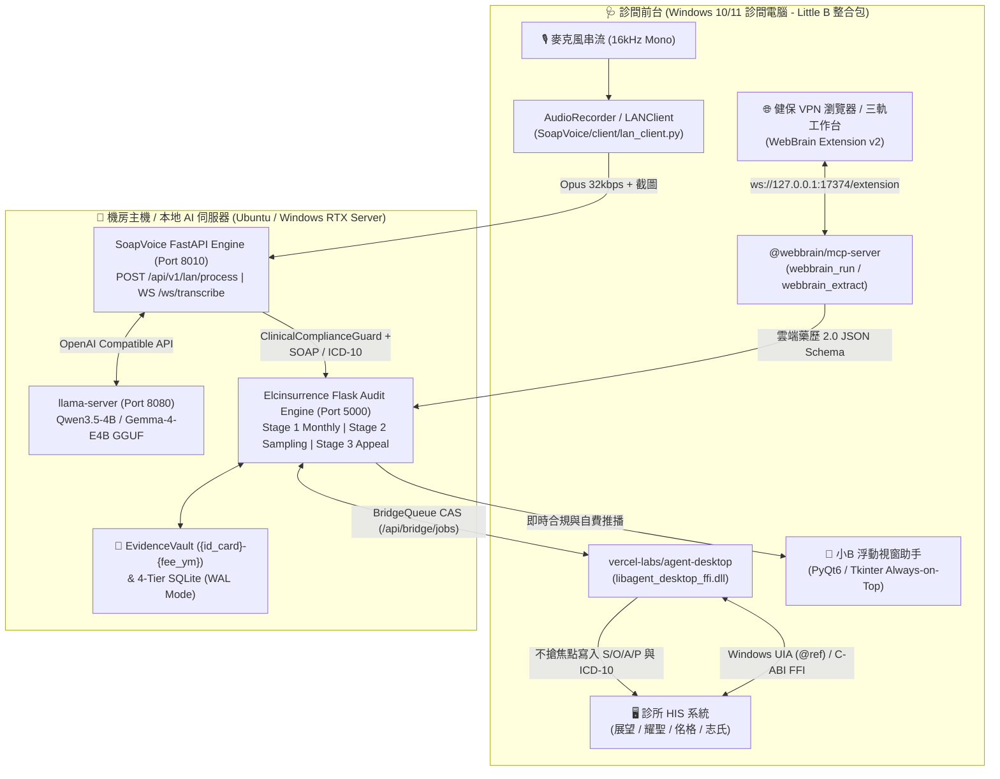

# 🏥 診所自費/健保雙軌 AI 決策系統 × Elcinsurrence × SoapVoice × Agent-Desktop × WebBrain 整合架構計畫書 (Plan v5.0)

> **文件版本**：v5.0 (Deep Research & Full-Stack Integration Blueprint)  
> **建立日期**：2026-11-04  
> **基準系統**：
> - **Elcinsurrence (`home-hsu-Desktop-Elcinsurrence`)**：三軌自動化健保審核與申復工作台（Flask Port `5000` / Phase 23 高密度雙欄 UI / Evidence Vault / Bridge Queue CAS）
> - **SoapVoice (`home-hsu-Desktop-Elcinsurrence-SoapVoice`)**：診間語音轉結構化 SOAP 醫療引擎與 LAN 分散式客戶端（FastAPI Port `8010` / Whisper + Qwen3-ASR / ClinicalComplianceGuard / Little B 浮動助手）
> - **Agent-Desktop (`vercel-labs/agent-desktop`)**：Rust 跨平台原生桌面 UI 自動化與 C-ABI FFI 引擎（Windows UIA / macOS AX / Linux AT-SPI，Observe–Act–Verify `@ref` 迴圈）
> - **WebBrain (`webbrain-one/webbrain`)**：Chromium 瀏覽器內嵌擴充套件與本地 MCP Bridge（`ws://127.0.0.1:17374/extension` Protocol v2，零登入牆健保 VPN 雲端藥歷預讀與三軌 UI 自動化驗證）

---
已完成對 Elcinsurrence、SoapVoice、vercel-labs/agent-desktop 與 webbrain-one/webbrain
  的跨專案深度調研（Deep Research）與知識圖譜分析，並正式寫入 plan-v5.md（參照舊版 plan-v4.md
  全面升級）。

  ### 📌 plan-v5.md 核心升級與整合重點

  1. 跨倉知識圖譜與真實程式碼對齊 (codebase-memory-mcp)
      • Elcinsurrence (Port
      5000)：完整映射三軌路由（monthly.py、sampling.py、appeal.py）、evidence_vault.py（以
      {id_card}-{fee_ym} 統一歸檔音訊/影像/報告並防止 Symlink 逃逸）、bridge_queue.py（CAS
      樂觀鎖與逾時回收）、以及純服務層（sampling_service.py、report_renderer.py、batch_reads.py）
      。
      • SoapVoice (Port 8010)：串聯 lan_process_api.py（POST /api/v1/lan/process Opus 32kbps
      轉碼與 ASR+SOAP 管線）、ClinicalComplianceGuard（比對 medical_nodes / medical_edges
      臨床圖譜之推薦用藥與飲食禁忌）、以及診間 LANClient 離線暫存與自動補傳機制。
  2. 深度整合 vercel-labs/agent-desktop（原生 HIS 桌面自動化引擎）
      • Observe–Act–Verify 閉環：利用 agent-desktop snapshot --app <HIS> -i --json 擷取 Windows
      UI Automation (UIA) 結構化樹並綁定確定性 @ref（如 @s8f3k2p9:e4），較傳統截圖 OCR 節省
      78%～96% Token。
      • 無頭背景寫入（Headless-by-Default）：預設透過 UIA ValuePattern (set-value @ref)
      直接寫入展望、耀聖、佲格、志氏等 HIS 的 S/O/A/P 與 ICD-10
      欄位，不搶奪醫師滑鼠與鍵盤焦點；並設計 STALE_REF 世代失效自動重試與剪貼簿三層 Fallback。
      • C-ABI FFI 穩定呼叫：整合 libagent_desktop_ffi.dll（panic = "unwind" 邊界保護與
      _Static_assert 結構對齊），供小B 客戶端透過 Python ctypes 直接在進程內安全調用。
  3. 深度整合 webbrain-one/webbrain（ws://127.0.0.1:17374/extension Protocol v2）
      • 健保 VPN 雲端藥歷 2.0
      零登入牆預讀：直接運行於醫師已插妥健保卡/醫事人員卡（HCA/SAM）的真實瀏覽器分頁，以
      mode="ask"（唯讀模式）搭配 webbrain_extract JSON Schema 擷取近 6
      個月跨院用藥、檢驗結果（HbA1c、LDL-C、eGFR）與重複用藥提示，並以 run_handoff_v1 處理 PIN
      碼人機交接。
      • 三軌工作台 E2E 自動化：對齊 Phase 23 index.html 與 test_stage2_3_buttons.py 中二階（13 顆
      #btn-s-*）與三階（11 顆 #btn-a-*）的 data-test-id 語意化錨點。
  4. 分階段落地路線圖 (Phase 24–26)
      • Phase 24：實作 /api/his/soapvoice-ingest 貫通 SoapVoice 語音輸出與 Elcinsurrence
      EvidenceVault 及雙軌（自費 + 健保 C 類）即時預審。
      • Phase 25：實作 WebBrain 雲端藥歷 2.0 webbrain_extract 自動匯入模組與 saved_workflows_v1。
      • Phase 26：封裝 agent-desktop UIA 回填模組與診間一鍵安裝包 ClinicClientInstaller.exe。

## 1. 執行摘要與「特洛伊木馬」雙軌商業戰略 (Executive Summary & Trojan Horse Strategy)

### 1.1 戰略定位：從「防禦健保核刪」到「驅動自費與醫療品質升級」
台灣基層診所與地區醫院長期面臨兩大核心痛點：
1. **健保合規與核刪壓力（防禦面）**：每月申報總檔（`TOTFA.zip`）、專業審查隨機抽樣（`CSV/XML`）、以及核減事後申復（`核減檔`）耗費大量醫師與行政人力；若 SOAP 病歷記載與健保支付標準（如 C 類支付規定、特殊藥品給付規定）脫鉤，即遭核刪或放大回推。
2. **診間看診時間壓縮與自費轉換瓶頸（營收面）**：醫師在 3～5 分鐘內需同時完成問診、打字、查閱健保雲端藥歷 2.0、開立醫令與衛教，缺乏即時 AI 臨床輔助工具將症狀導向「高合規健保處置」或「高價值自費檢測/療程」。

本計畫書（`plan-v5.md`）在 [`plan-v4.md`](file:///home/hsu/Desktop/Elcinsurrence/plan-v4.md) 的基礎上，結合 **Codebase Memory MCP 跨倉知識圖譜分析**（涵蓋 `Elcinsurrence` 9,693 節點與 `SoapVoice` 2,782 節點），並深度整合兩大次世代 Agent 自動化引擎——**`vercel-labs/agent-desktop`**（原生 HIS 桌面控制）與 **`webbrain-one/webbrain`**（瀏覽器活體 Session 與 VPN 藥歷萃取），打造無縫閉環的醫療 AI 作業系統。



---

## 2. 跨專案知識圖譜與現況盤點 (Codebase Memory MCP Deep Audit)

透過 `codebase-memory-mcp` 對工作區雙專案進行結構化索引與跨專案 HTTP 邊界追蹤（`cross-repo-intelligence`），系統現況架構如下：

### 2.1 `Elcinsurrence` 健保三軌審核與申復引擎 (`Port 5000`)
| 模組層級 | 關鍵檔案與符號 (Clickable Links) | 核心職責與已實作特性 (Phase 15–23) |
| :--- | :--- | :--- |
| **API 路由層** | [`src/elc_audit_engine/api/routes/monthly.py`](file:///home/hsu/Desktop/Elcinsurrence/src/elc_audit_engine/api/routes/monthly.py)<br>[`src/elc_audit_engine/api/routes/sampling.py`](file:///home/hsu/Desktop/Elcinsurrence/src/elc_audit_engine/api/routes/sampling.py)<br>[`src/elc_audit_engine/api/routes/appeal.py`](file:///home/hsu/Desktop/Elcinsurrence/src/elc_audit_engine/api/routes/appeal.py) | 完整支援 **第一階（當月 `TOTFA.zip` 預審）**、**第二階（抽樣事前預審 CSV/XML）**、**第三階（核減事後申復）** 之多軌 REST API。 |
| **佐證庫與橋接層** | [`src/elc_audit_engine/evidence_vault.py`](file:///home/hsu/Desktop/Elcinsurrence/src/elc_audit_engine/evidence_vault.py) (`VaultFile`, `list_vault_files`, `get_vault_file`)<br>[`src/elc_audit_engine/bridge_queue.py`](file:///home/hsu/Desktop/Elcinsurrence/src/elc_audit_engine/bridge_queue.py) (`enqueue_job`, `report_status`)<br>[`src/elc_audit_engine/api/routes/his_integration.py`](file:///home/hsu/Desktop/Elcinsurrence/src/elc_audit_engine/api/routes/his_integration.py) | 以 `{id_card}-{fee_ym}`（如 `A123456789-2307`）作為跨階段統一歸檔鍵，防範目錄穿越與 Symlink 逃逸；`BridgeQueue` 支援 CAS（Compare-And-Swap）樂觀鎖與逾時任務回收。 |
| **純業務服務層** | [`src/elc_audit_engine/services/sampling_service.py`](file:///home/hsu/Desktop/Elcinsurrence/src/elc_audit_engine/services/sampling_service.py)<br>[`src/elc_audit_engine/services/report_renderer.py`](file:///home/hsu/Desktop/Elcinsurrence/src/elc_audit_engine/services/report_renderer.py)<br>[`src/elc_audit_engine/services/batch_reads.py`](file:///home/hsu/Desktop/Elcinsurrence/src/elc_audit_engine/services/batch_reads.py) | 抽離 Flask Context 的純函式服務層；`batch_reads.py` 實作 1,000 筆上限截斷保護與 `truncated` 標記；`report_renderer.py` 統一渲染三軌檢視卡片與佐證畫廊。 |
| **核心比對與生成** | [`src/elc_audit_engine/comparator/`](file:///home/hsu/Desktop/Elcinsurrence/src/elc_audit_engine/comparator)<br>[`src/elc_audit_engine/generators/appeal.py`](file:///home/hsu/Desktop/Elcinsurrence/src/elc_audit_engine/generators/appeal.py)<br>[`src/elc_audit_engine/generators/sampling_xml.py`](file:///home/hsu/Desktop/Elcinsurrence/src/elc_audit_engine/generators/sampling_xml.py) | 三方比對引擎（病歷 SOAP × 六個月歷史時間軸 × 健保支付標準 SQLite/Chroma）、四段式申復書生成、以及 Big5 健保申報 XML / 三聯單 ODT 匯出。 |
| **Phase 23 前端工作台** | [`static/index.html`](file:///home/hsu/Desktop/Elcinsurrence/static/index.html)<br>[`tests/test_stage2_3_buttons.py`](file:///home/hsu/Desktop/Elcinsurrence/tests/test_stage2_3_buttons.py) | `140px` 極窄側邊欄、`F11` 全螢幕雙向切換、DOM-safe `#floatingTooltip` 浮動字幕、1/2/3 階等高 `.workflow-topbar`，並為二階與三階共 24 個操作按鈕掛載語意化 `id` 與 `data-test-id`。 |

### 2.2 `SoapVoice` 診間語音轉結構化 SOAP 引擎 (`Port 8010`)
| 模組層級 | 關鍵檔案與符號 (Clickable Links) | 核心職責與已實作特性 |
| :--- | :--- | :--- |
| **LAN 語音與醫療 API** | [`SoapVoice/src/api/lan_process_api.py`](file:///home/hsu/Desktop/Elcinsurrence/SoapVoice/src/api/lan_process_api.py) (`process_lan_consultation`, `LANProcessResponse`)<br>[`SoapVoice/src/api/websocket.py`](file:///home/hsu/Desktop/Elcinsurrence/SoapVoice/src/api/websocket.py) (`/ws/transcribe`)<br>[`SoapVoice/src/main.py`](file:///home/hsu/Desktop/Elcinsurrence/SoapVoice/src/main.py) (`lan_whitelist_middleware`, `is_lan_ip`) | 接收診間客戶端上傳之 WAV/Opus 音訊與病歷截圖，驗證 LAN IP 白名單（防護 T-11-01 Spoofing），轉交 `ExtendedSoapVoiceEngine` 產出結構化 SOAP。 |
| **多引擎 ASR 轉錄層** | [`SoapVoice/src/asr/whisper_model.py`](file:///home/hsu/Desktop/Elcinsurrence/SoapVoice/src/asr/whisper_model.py)<br>[`SoapVoice/src/asr/qwen3asr_model.py`](file:///home/hsu/Desktop/Elcinsurrence/SoapVoice/src/asr/qwen3asr_model.py)<br>[`SoapVoice/src/asr/audiocpp_model.py`](file:///home/hsu/Desktop/Elcinsurrence/SoapVoice/src/asr/audiocpp_model.py) | 支援 `faster-whisper`、`Qwen3-ASR` 與 `audio.cpp` 本地推理，內建醫療專有名詞詞庫（`vocabulary.py`）與中英台語混雜語音補償。 |
| **NLP 與臨床合規守門員** | [`SoapVoice/src/nlp/compliance_guard.py`](file:///home/hsu/Desktop/Elcinsurrence/SoapVoice/src/nlp/compliance_guard.py) (`ClinicalComplianceGuard.check_compliance`)<br>[`SoapVoice/src/nlp/icd10_classifier.py`](file:///home/hsu/Desktop/Elcinsurrence/SoapVoice/src/nlp/icd10_classifier.py)<br>[`SoapVoice/src/consultation/consultation_flow.py`](file:///home/hsu/Desktop/Elcinsurrence/SoapVoice/src/consultation/consultation_flow.py) | 自動分類 S/O/A/P 段落與 ICD-10-CM 代碼，並透過 `ClinicalComplianceGuard` 比對 `medical_nodes` 與 `medical_edges` 圖譜（檢查飲食禁忌 `no_eat` 與建議用藥 `recommand_drug`）。 |
| **LAN 離線容錯客戶端** | [`SoapVoice/client/lan_client.py`](file:///home/hsu/Desktop/Elcinsurrence/SoapVoice/client/lan_client.py) (`LANClient`)<br>[`SoapVoice/client/retry_manager.py`](file:///home/hsu/Desktop/Elcinsurrence/SoapVoice/client/retry_manager.py)<br>[`SoapVoice/client/audio_recorder.py`](file:///home/hsu/Desktop/Elcinsurrence/SoapVoice/client/audio_recorder.py) | 內建 `LocalStorageManager`（`pending/queue.json` 持久化）、`RetryManager` 指數退避重試，當伺服器由 `offline` 恢復為 `healthy` 時自動觸發 `retry_pending_uploads`。 |

---

## 3. LAN 分散式網路拓撲與零配置發現協定 (ZeroConf & LAN Gateway)

為確保診所多診間環境「免 IT 人員駐點、插電即用」，系統採 **雙層零配置發現機制（Dual-Layer ZeroConf）** 與 **統一本地 API 閘道**：

### 3.1 零配置服務探索 (mDNS + UDP Port 5001 Fallback)
1. **Primary (mDNS / Zeroconf)**：
   - 機房伺服器啟動時透過 Python `zeroconf` 廣播 `_clinicai._tcp.local.`，夾帶 TXT 紀錄：`{"elc_port": "5000", "soap_port": "8010", "llama_port": "8080", "api_ver": "v5"}`。
2. **Fallback (UDP Broadcast Heartbeat - Port `5001`)**：
   - 針對部分關閉 Multicast 的診所舊型路由器，機房主機每 **3 秒**向區網廣播位址（`255.255.255.255:5001` 及子網廣播）發送簽章 Beacon：
     ```json
     {
       "service": "ELC_SOAP_SERVER_V5",
       "elc_url": "http://192.168.1.100:5000",
       "soap_url": "http://192.168.1.100:8010",
       "timestamp": 1793779200,
       "hmac_prefix": "9f86d081"
     }
     ```
   - 診間 [`LANClient`](file:///home/hsu/Desktop/Elcinsurrence/SoapVoice/client/lan_client.py) 監聽 UDP `5001`，一旦捕獲合法 Beacon 即自動更新 `LANConfig.server_url`，無須手動輸入 IP。

### 3.2 跨服務埠口配置與安全邊界
| 服務元件 | 綁定範圍 | 預設 Port | 認證與安全防護機制 |
| :--- | :--- | :--- | :--- |
| **Elcinsurrence 主審核工作台** | `0.0.0.0` (LAN) | `5000` | `X-API-Key` / 機構代碼自動授權 + [`bridge_queue.py`](file:///home/hsu/Desktop/Elcinsurrence/src/elc_audit_engine/bridge_queue.py) CAS 鎖定 |
| **SoapVoice 語音與醫療引擎** | `0.0.0.0` (LAN) | `8010` | [`lan_whitelist_middleware`](file:///home/hsu/Desktop/Elcinsurrence/SoapVoice/src/main.py#L75-L99)（僅放行 `192.168.*`、`10.*`、`127.0.0.1`） |
| **llama-server 本地推論引擎** | `127.0.0.1` / LAN | `8080` | 僅供機房內部 `Elcinsurrence` 與 `SoapVoice` 呼叫，不暴露外網 |
| **WebBrain Local MCP Bridge** | `127.0.0.1` (Loopback) | `17374` | `ws://127.0.0.1:17374/extension` + Pairing Key 一次性配對金鑰驗證 |
| **Agent-Desktop 執行層** | In-Process / Local CLI | N/A | 本機 Process 呼叫 `libagent_desktop_ffi.dll` 或 `agent-desktop.exe` |

---

## 4. 深度整合一：`vercel-labs/agent-desktop` 原生 HIS 跨平台自動化引擎

傳統診所 HIS 系統（如展望、耀聖、佲格、志氏、常誠）多為 Windows 原生桌面應用（Win32 / WPF / Delphi / VB6 / .NET WinForms）。在 `plan-v4.md` 中僅以概要提及 `agent-desktop`；在 `plan-v5.md` 中，我們引入其完整 **Rust 核心架構、Windows UIA 適配器、Observe–Act–Verify `@ref` 狀態機與 C-ABI FFI 介面**。

### 4.1 `vercel-labs/agent-desktop` 技術架構解析
1. **Rust 核心與 `PlatformAdapter` 抽象層**：
   - 底層以 `agent-desktop-core` (Rust) 實作，透過統一的 `PlatformAdapter` Trait 封裝三大作業系統原生輔助功能 API：
     - **Windows**：UI Automation (`UIA` COM API，`IUIAutomationElement`、`IUIAutomationValuePattern`、`IUIAutomationInvokePattern`)
     - **macOS**：Accessibility API (`AXUIElement`)
     - **Linux**：`AT-SPI2` D-Bus 協定（供開發機 Ubuntu 測試模擬 HIS 視窗）
2. **Token 節省 78%～96% 的結構化快照 (`snapshot -i`)**：
   - 不依賴高延遲、高 Token 消耗且易受解析度影響的螢幕截圖 OCR（Vision LLM），而是直接擷取原生 Accessibility Tree，過濾無意義容器，僅輸出可互動元素（Interactive Elements），並賦予確定性 **`@ref` 識別碼**（格式如 `@s8f3k2p9:e1`、`@s8f3k2p9:e8`，前綴為 Snapshot 世代雜湊，後綴為元素序號）。
3. **Headless-by-Default（預設無頭背景執行，不搶奪醫師滑鼠焦點）**：
   - `agent-desktop` 預設透過 UIA `ValuePattern.SetValue()` 與 `InvokePattern.Invoke()` 直接向目標視窗控制項注入文字或觸發事件，**完全不移動實體滑鼠游標、不搶奪醫師當前鍵盤焦點**。僅在老舊 Delphi/VB6 自繪控制項不支援 `ValuePattern` 時，才以 `--headed` 或剪貼簿貼上降級處理。
4. **C-ABI FFI 動態連結庫 (`libagent_desktop_ffi.dll` / `libagent_desktop_ffi.so`)**：
   - 內建 `agent-desktop-ffi` crate，編譯時強制啟用 `panic = "unwind"` 並在每個 `extern "C"` 邊界以 `std::panic::catch_unwind` 攔截 Rust Panic，轉換為 `AD_RESULT_ERR_INTERNAL` 錯誤碼，確保 Python 主程式（小B 客戶端）透過 `ctypes` / `cffi` 呼叫時絕不因底層異常而崩潰；標頭檔 `agent_desktop.h` 內建 C11 `_Static_assert` 結構體對齊檢查。

### 4.2 Observe–Act–Verify 閉環與 HIS 欄位寫入協定

```mermaid
sequenceDiagram
    autonumber
    participant Doc as 👨‍⚕️ 醫師 / 小B 助手
    participant BQ as 🔄 Elcinsurrence BridgeQueue
    participant AD as 🦀 agent-desktop (UIA / FFI)
    participant HIS as 🖥️ 診所 HIS 視窗 (展望/耀聖)

    Doc->>BQ: 點擊「一鍵寫入 HIS」或語音指令確認
    BQ->>BQ: enqueue_job(s_type_code="HIS_PUSH", status="PENDING")
    AD->>BQ: 輪詢 / 領取任務 → report_status(expected="PENDING", new="SENDING")
    
    rect rgb(20, 40, 60)
        Note over AD,HIS: Phase 1: OBSERVE (結構化快照與世代雜湊綁定)
        AD->>HIS: agent-desktop snapshot --app "展望診療系統" -i --json
        HIS-->>AD: 回傳 Accessibility Tree JSON (Snapshot ID: s8f3k2p9)<br/>@s8f3k2p9:e4 [Edit "主訴 S"]<br/>@s8f3k2p9:e5 [Edit "客觀 O"]<br/>@s8f3k2p9:e8 [Edit "診斷 ICD-10"]
    end

    rect rgb(30, 55, 40)
        Note over AD,HIS: Phase 2: ACT (無頭背景注入，不移動醫師滑鼠)
        AD->>HIS: set-value @s8f3k2p9:e4 "喉嚨痛三天，伴隨低燒..."
        AD->>HIS: set-value @s8f3k2p9:e5 "Pharynx injected, tonsils Grade I..."
        AD->>HIS: set-value @s8f3k2p9:e8 "J02.9"
    end

    alt 視窗重繪導致 @ref 失效 (Disposition: STALE_REF)
        HIS-->>AD: Error: STALE_REF (視窗已切換或重繪)
        AD->>HIS: 自動重新執行 snapshot 取得新世代 @s9a1b2c3:e4 並重試
    else 寫入成功
        rect rgb(50, 40, 65)
            Note over AD,HIS: Phase 3: VERIFY (讀回驗證確保零掉字)
            AD->>HIS: get-value @s8f3k2p9:e4 / @s8f3k2p9:e8
            HIS-->>AD: 確認欄位值與目標 Payload SHA-256 相符
        end
        AD->>BQ: report_status(expected="SENDING", new="SUCCESS")
    end
```



### 4.3 各大 HIS 廠商設定檔 (`his_profiles.json`) 與自動校準精靈
診間小B 內建 `his_profiles.json`，支援 **30 秒互動式綁定精靈（Calibration Wizard）**：
1. 初次安裝時，執行 `agent-desktop snapshot --app <HIS_EXE> -i` 列出所有 `role="Edit"` / `role="Document"` 控制項。
2. 透過 UIA `AutomationId`、`Name`、或相對樹狀路徑（Tree Path）自動匹配 S / O / A / P / ICD-10 欄位，無須硬編碼螢幕 `(X, Y)` 座標。
3. **多層寫入退避策略（3-Tier Fallback）**：
   - **Tier 1 (UIA ValuePattern)**：`agent-desktop set-value @ref "<text>"`（最快、不搶焦點）。
   - **Tier 2 (UIA Focus + Clipboard Paste)**：若老舊 VB6 控制項不支援 `ValuePattern`，則以 `agent-desktop clipboard set "<text>"` + `focus @ref` + `key "ctrl+v"` 寫入，並在 50ms 內還原醫師原始剪貼簿內容。
   - **Tier 3 (Floating Copy Card)**：若 HIS 處於鎖定彈窗狀態，小B 自動亮起「點擊複製區段」按鈕並發出輕微提示音。

---

## 5. 深度整合二：`webbrain-one/webbrain` 瀏覽器活體自動化與健保 VPN 藥歷預讀

在診所實務中，**健保醫療資訊雲端查詢系統 2.0（雲端藥歷 / 檢驗檢查結果 / 手術紀錄）** 必須運行於已插妥醫事人員卡（HCA）與健保卡（SAM 模組認證）的瀏覽器活體 Session 中。傳統 Playwright/Selenium 無頭瀏覽器一旦啟動新 Profile 就會失去健保 VPN 憑證與 Smartcard Session，導致登入失敗。

透過整合 **`webbrain-one/webbrain`**（我們已於本機驗證並啟動 `@webbrain/mcp-server` 綁定 `ws://127.0.0.1:17374/extension`），AI 得以直接寄生於醫師正在使用的真實 Chrome/Edge 分頁中安全作業。

### 5.1 WebBrain Protocol v2 核心架構與能力矩陣
在我們實測的 `@webbrain/mcp-server` 握手紀錄中，WebBrain Extension v0.2.1 透過 `ws://127.0.0.1:17374/extension` 暴露以下 **Protocol v2 生產級能力**：
- **`run_modes_v1` (`ask` vs `act` 雙模式安全隔離)**：
  - `mode="ask"`（唯讀模式）：僅允許讀取 DOM、Accessibility 快照與擷取頁面結構化資料，嚴格禁止任何點擊、表單修改或送出動作——**專用於「健保雲端藥歷 2.0 背景預讀」**。
  - `mode="act"`（執行模式）：允許點擊按鈕、填寫申復理由、上傳檔案——**專用於「Elcinsurrence 三軌工作台自動化操作與 E2E 驗收」**。
- **`webbrain_extract` (JSON Schema 強制結構化萃取)**：
  - 傳入目標 URL / Tab 條件與嚴格的 JSON Schema，直接從健保 VPN 雲端藥歷頁面萃取近 6 個月用藥、檢驗值（如 HbA1c、LDL-C、eGFR）與重複用藥警示，直接匯入 `Elcinsurrence` 三方比對引擎。
- **`saved_workflows_v1` & `scheduled_jobs_v1` (固化工作流與排程)**：
  - 將「每月健保署 VPN 審查結果下載」與「雲端藥歷跨院用藥擷取」固化為確定性 Workflow，支援定時或事件觸發執行。
- **`run_handoff_v1` (人機協同交接 Human-in-the-Loop)**：
  - 當遇到健保卡 PIN 碼輸入框、醫事人員卡簽章確認、或高風險申報送出按鈕時，WebBrain 自動觸發 `run_handoff_v1` 暫停自動化並通知醫師手動確認，確認後無縫接續執行，完美符合醫療法規與資安要求。
- **`private_results_v1` (本地隱私資料隔離)**：
  - 確保從健保 VPN 擷取之病患敏感資料（PHI）僅在本地 Loopback (`127.0.0.1:17374`) 與機房 `Elcinsurrence` 之間流轉，絕不外洩至第三方雲端。

### 5.2 健保雲端藥歷 2.0 預讀 Schema 與三方比對聯動
當病患插入健保卡、HIS 觸發雲端藥歷查詢視窗或瀏覽器分頁時，小B 透過 `webbrain_extract` (`mode="ask"`) 執行以下結構化萃取：

```json
{
  "tool": "webbrain_extract",
  "arguments": {
    "goal": "從當前健保醫療資訊雲端查詢系統 2.0 分頁中，擷取病患近 6 個月跨院門診用藥紀錄、最近一次檢驗檢查結果（HbA1c, Creatinine, eGFR, LDL-C）與重複用藥提示。",
    "schema": {
      "type": "object",
      "required": ["nhi_med_history", "recent_labs", "duplicate_alerts"],
      "properties": {
        "nhi_med_history": {
          "type": "array",
          "items": {
            "type": "object",
            "properties": {
              "visit_date_roc": { "type": "string", "description": "就醫民國日期，如 1120715" },
              "facility_name": { "type": "string" },
              "nhi_drug_code": { "type": "string", "description": "10碼健保藥品代碼" },
              "drug_name": { "type": "string" },
              "days": { "type": "integer" }
            }
          }
        },
        "recent_labs": {
          "type": "array",
          "items": {
            "type": "object",
            "properties": {
              "item_name": { "type": "string" },
              "value": { "type": "string" },
              "unit": { "type": "string" },
              "report_date_roc": { "type": "string" }
            }
          }
        },
        "duplicate_alerts": {
          "type": "array",
          "items": { "type": "string" }
        }
      }
    }
  }
}
```

萃取結果直接寫入 `Elcinsurrence` 的病患歷史時間軸，實現：
1. **即時重複開藥攔截**：看診當下若醫師準備開立同類藥物（如跨院已領取 Statin 或 NSAIDs 尚有餘藥），小B 立即跳出紅燈警示。
2. **檢驗數值自動帶入 SOAP `O` 段与申復佐證**：例如開立降血脂藥或糖尿病用藥時，自動將雲端藥歷查得之 `HbA1c` / `LDL-C` 檢驗日期與數值填入 SOAP `Objective`，從源頭消滅「未附檢驗報告或數值不符支付規定」之核刪。

### 5.3 Elcinsurrence 三軌工作台語意化 DOM 綁定 (Stage 1 / 2 / 3 Automation)
在 [`static/index.html`](file:///home/hsu/Desktop/Elcinsurrence/static/index.html) 與 [`tests/test_stage2_3_buttons.py`](file:///home/hsu/Desktop/Elcinsurrence/tests/test_stage2_3_buttons.py) 中，我們已全面完成與 WebBrain 對齊的語意化 `id` 與 `data-test-id` 錨點設計，讓 WebBrain 可透過自然語言或 Saved Workflow 精準操控三軌工作台：

| 工作台階段 | 按鈕群組 | 語意化 `id` / `data-test-id` 錨點規範 | WebBrain 自動化應用場景 |
| :--- | :--- | :--- | :--- |
| **全域導覽與視窗** | 頂部導覽與全螢幕 | `#navStage1Btn`, `#navStage2Btn`, `#navStage3Btn`, `#fullscreenBtn` (`F11`) | 自動切換一/二/三階視圖、開啟全螢幕高密度審閱模式 |
| **第一階：當月預審** | `TOTFA.zip` 批次預審 | `#uploadTotfaBtn`, `#openVisualCardsBtn`, `#seedDemoBtn`, `#clearMonthlyBtn` | 每月底自動載入 HIS 匯出之 `TOTFA.zip`、執行全院高風險醫令掃描 |
| **第二階：抽樣預審** | 抽樣清單與申報打包 | `#btn-s-upload-csv` (`stage2-upload-csv`) ～ `#btn-s-export-nhi-zip` (`stage2-export-nhi-zip`) 共 **13 顆按鈕** | 自動匯入健保署抽審 CSV、批次從 HIS 調閱病歷、對齊 Evidence Vault 佐證、一鍵產出 `NHI_EIIAPI` 電子抽審壓縮包 |
| **第三階：核減申復** | 核減匯入與四段申復 | `#btn-a-upload-file` (`stage3-upload-file`) ～ `#btn-a-export-nhi-zip` (`stage3-export-nhi-zip`) 共 **11 顆按鈕** | 自動匯入核減檔、關聯前期抽審病歷、批次生成四段式 AI 申復理由、產出三聯單 ODT/PDF 與 Big5 XML |

---

## 6. 診間語音轉結構化 SOAP 與雙軌決策流 (`SoapVoice` × `Elcinsurrence`)

本章節定義從「病患踏入診間說話」到「產出合規 SOAP + 自費建議 + 寫入 HIS + 歸檔 Evidence Vault」的完整資料管線。

### 6.1 端到端即時音訊與臨床推理管線
1. **音訊採集與壓縮 ([`SoapVoice/client/audio_recorder.py`](file:///home/hsu/Desktop/Elcinsurrence/SoapVoice/client/audio_recorder.py))**：
   - 採樣率 `16,000 Hz`、單聲道（Mono）、16-bit PCM。
   - 支援兩大模式：
     - **串流模式 (`WS /ws/transcribe`)**：[`StreamTranscriber`](file:///home/hsu/Desktop/Elcinsurrence/SoapVoice/src/asr/stream_transcriber.py) 即時回傳逐字稿片段至小B 浮動字幕。
     - **完整診次處理 (`POST /api/v1/lan/process`)**：[`process_lan_consultation`](file:///home/hsu/Desktop/Elcinsurrence/SoapVoice/src/api/lan_process_api.py#L96-L292) 接收音訊與病歷截圖，自動轉碼為 **Opus 32kbps** 封存於 `data/lan_sessions/{session_id}/`，節省 85% 區網頻寬與硬碟空間。
2. **雙階段混合檢索 (SQLite FTS5 + PageIndex / Chroma RAG)**：
   - **Stage A (SQLite FTS5 毫秒級關鍵字召回)**：從逐字稿提取症狀、藥物與處置關鍵字，於 5ms 內召回對應之 ICD-10-CM 候選碼、診所自費品項（`clinic_self_pay_items`）與健保支付標準條文編號。
   - **Stage B (PageIndex 樹狀推理 + Chroma 語意檢索)**：針對複雜適應症（如慢性病合併症、高價影像檢查、特殊藥品給付規定），調閱 [`rule_repository`](file:///home/hsu/Desktop/Elcinsurrence/src/elc_audit_engine/rule_repository) 之完整法規樹與 [`CaseTemplateRAG`](file:///home/hsu/Desktop/Elcinsurrence/SoapVoice/src/rag/case_template_rag.py) 臨床範本。
3. **臨床圖譜合規守門員 ([`ClinicalComplianceGuard`](file:///home/hsu/Desktop/Elcinsurrence/SoapVoice/src/nlp/compliance_guard.py#L18-L99))**：
   - 在 LLM 生成 `S/O/A/P` 後，同步透過 `ClinicalComplianceGuard.check_compliance()` 查詢 `medical_nodes` 與 `medical_edges`：
     - 驗證 `Assessment` 診斷與 `Plan` 處置用藥是否符合 `recommand_drug` / `common_drug` 關係。
     - 攔截處置或衛教中包含疾病忌吃食物（`no_eat`）或配伍禁忌，產出 `CRITICAL` / `INFO` 等級結構化警示。

### 6.2 統一雙軌決策 JSON 輸出規格 (Dual-Track Decision Payload)
機房伺服器整合 `SoapVoice` 與 `Elcinsurrence` 規則引擎後，以單一 JSON Schema 回傳至診間小B：

```json
{
  "session_id": "20261104-153012-A123",
  "vault_key": "A123456789-2611",
  "soap": {
    "subjective": "持續性雙膝關節疼痛已逾 6 個月，上下樓梯加劇，曾服用口服 NSAIDs 效果不佳。",
    "objective": "Bilateral knee crepitus (+), mild effusion, ROM 0-110 deg. X-ray (2026-11-04): Kellgren-Lawrence Grade II osteoarthritis.",
    "assessment": "M17.0 Bilateral primary osteoarthritis of knee",
    "plan": "1. 衛教減重與股四頭肌訓練\n2. 評估關節腔內注射治療"
  },
  "icd10_candidates": [
    { "code": "M17.0", "name_zh": "雙側原發性膝關節炎", "confidence": 0.96 }
  ],
  "nhi_compliance_track": {
    "risk_level": "WARNING",
    "rule_code": "39004C / 玻尿酸關節腔注射給付規定",
    "missing_criteria": [
      "健保申報玻尿酸注射須載明「同一院所保守治療（含藥物或復健）滿 6 個月無效」之確切起訖日期與紀錄，且不得與類固醇注射或復健同日申報。"
    ],
    "auto_remediation_soap": "建議於 S 段補入本院前期保守治療起訖日期，或改走自費高濃度血小板 (PRP) / 自費長效玻尿酸療程。"
  },
  "self_pay_track": [
    {
      "item_code": "SP-ORTHO-01",
      "item_name": "高濃度血小板血漿 (PRP) 關節修復注射",
      "price_ntd": 15000,
      "clinical_rationale": "患者口服 NSAIDs 效果不佳且屬 KL Grade II 退化性關節炎，符合增生修復適應症。",
      "pitch_script": "您的膝蓋軟骨目前處於第二期磨損，若不想長期吃消炎止痛藥傷胃，除了傳統健保條件較嚴格的注射外，目前可以考慮自費 PRP 自體血小板修復注射，直接幫助軟骨周邊組織修復。"
    }
  ],
  "clinical_graph_warnings": [
    {
      "type": "INFO",
      "message": "【用藥驗證】診斷為「退化性關節炎」，處置計畫符合臨床圖譜指引。"
    }
  ]
}
```

---

## 7. Elcinsurrence 三軌審核、Evidence Vault 與 Phase 23 高密度 UI 架構

### 7.1 三軌核心工作流 (Stage 1 / Stage 2 / Stage 3)
1. **第一階：當月申報檔預審 (`Stage 1: Monthly Pre-Audit`)**
   - **輸入**：HIS 匯出之當月申報總檔 `TOTFA.zip`（由 [`totfa.py`](file:///home/hsu/Desktop/Elcinsurrence/src/elc_audit_engine/parsers/totfa.py) 串流解析 XML/扁平檔）。
   - **處理**：全量掃描當月數千筆門診案件，針對高單價醫令、特殊藥品、C 類支付標準、重複開藥、診斷碼與醫令不符進行紅黃綠燈分級，並透過 [`monthly_report_html.py`](file:///home/hsu/Desktop/Elcinsurrence/src/elc_audit_engine/monthly_report_html.py) 產出互動式視覺化審核卡片。
   - **價值**：在每月 1～5 號正式送出健保總檔前，讓醫師直接在 HIS 修正高風險病歷，從源頭將核刪率降至最低。
2. **第二階：抽樣事前預審與電子抽審打包 (`Stage 2: Sampling Pre-Audit & NHI Packager`)**
   - **輸入**：健保署 VPN 下載之抽審清單 CSV（或由 WebBrain 自動擷取匯入）。
   - **處理**：
     - 透過 [`sampling_service.py`](file:///home/hsu/Desktop/Elcinsurrence/src/elc_audit_engine/services/sampling_service.py) 自動匹配歷史病歷與 **6 個月時間軸（Six-Month Timeline）**。
     - 自動掛載 [`evidence_vault.py`](file:///home/hsu/Desktop/Elcinsurrence/src/elc_audit_engine/evidence_vault.py) 中屬於該病患當月（`{id_card}-{fee_ym}`）的所有佐證檔案（`audio` 問診錄音、`images` 醫療影像、`reports` 檢驗報告 PDF、`other` 其他附件）。
     - 一鍵匯出符合健保署 `NHI_EIIAPI` 規範之電子抽審 ZIP 壓縮包（[`sampling_xml.py`](file:///home/hsu/Desktop/Elcinsurrence/src/elc_audit_engine/generators/sampling_xml.py)），並排入 [`bridge_queue.py`](file:///home/hsu/Desktop/Elcinsurrence/src/elc_audit_engine/bridge_queue.py) 供地端 Agent 上傳。
3. **第三階：核減事後申復 (`Stage 3: Post-Deduction Appeal`)**
   - **輸入**：健保署核減通知檔（CSV / XML / PDF）。
   - **處理**：
     - 透過 [`appeal_linkage.py`](file:///home/hsu/Desktop/Elcinsurrence/src/elc_audit_engine/appeal_linkage.py) 自動串聯該案件在第一階/第二階之原始 SOAP、6 個月病程與 Evidence Vault 佐證檔。
     - 呼叫 [`generators/appeal.py`](file:///home/hsu/Desktop/Elcinsurrence/src/elc_audit_engine/generators/appeal.py) 產出 **四段式結構化申復理由**（一、核刪理由摘要與爭點；二、病患臨床病程與客觀檢查佐證；三、健保支付標準與醫學實證依據；四、綜上懇請貴署惠予補付）。
     - 支援一鍵匯出 **爭議審議/申復三聯單 ODT/PDF**（[`appeal_print/`](file:///home/hsu/Desktop/Elcinsurrence/src/elc_audit_engine/generators/appeal_print)）及 **Big5 編碼申復 XML**（[`appeal_xml.py`](file:///home/hsu/Desktop/Elcinsurrence/src/elc_audit_engine/generators/appeal_xml.py)）。

### 7.2 Phase 23 高密度雙欄工作台 UI 規範 ([`static/index.html`](file:///home/hsu/Desktop/Elcinsurrence/static/index.html))
為適應醫師與申報人員在雙螢幕或分割視窗下的高強度審閱需求，Phase 23 已實作並固化以下 UI 工程規範：
1. **左欄極窄化 (`140px` 固定寬度)**：
   - 側邊欄由傳統 `280px` 縮減一半至 `140px`，最大化右側主作業區（占螢幕寬度 `>88%`）。
   - 頂部工具列按鈕濃縮為 `+ 鍵入`、`📂 匯入`、`🧹 清快取`；院所機構代碼與月份狀態列採雙行緊湊排版，API Key 與規則庫管理收折為 `<details class="quick-panel">`。
2. **DOM-Safe 浮動字幕 (`#floatingTooltip`)**：
   - 當滑鼠懸停於 `140px` 窄欄內的案件卡片或截斷文字時，透過 `position: fixed; z-index: 9999` 的 `#floatingTooltip`（完全使用 `createElement` + `textContent` 建構，杜絕 XSS）在右側浮現完整病患 ID、就醫日、核刪代碼與申復狀態。
3. **F11 全螢幕沉浸模式 (`#fullscreenBtn`)**：
   - 支援鍵盤 `F11` 與頂部按鈕雙向切換 `document.documentElement.requestFullscreen()`，並監聽 `fullscreenchange` 自動同步圖示狀態。
4. **1 / 2 / 3 階介面尺寸完全對齊**：
   - 統一 `.workflow-topbar`（`min-height: 58px`）與 `.view-scroll-content`（`height: calc(100vh - 150px)`），切換第一、二、三階時視覺零跳動。

---

## 8. 統一編排器與 `BridgeQueue` 原子狀態機 (Unified Orchestration & CAS Queue)

為了協調機房伺服器（`Elcinsurrence` + `SoapVoice`）與多台診間電腦上的地端代理（`agent-desktop`、[`LANClient`](file:///home/hsu/Desktop/Elcinsurrence/SoapVoice/client/lan_client.py)、`WebBrain`、以及健保署 `NHI_EIIAPI` 上傳代理），系統採用基於 SQLite JSON 欄位索引與 **CAS (Compare-And-Swap)** 樂觀鎖的 [`BridgeQueue`](file:///home/hsu/Desktop/Elcinsurrence/src/elc_audit_engine/bridge_queue.py)。

### 8.1 `BridgeQueue` 狀態轉換與逾時回收機制
在 [`src/elc_audit_engine/bridge_queue.py`](file:///home/hsu/Desktop/Elcinsurrence/src/elc_audit_engine/bridge_queue.py) 與 [`src/elc_audit_engine/case_store/store.py`](file:///home/hsu/Desktop/Elcinsurrence/src/elc_audit_engine/case_store/store.py) 中：
- **合法狀態轉換圖**：
  - `PENDING` $\xrightarrow{\text{Agent 領取 (CAS)}}$ `SENDING`
  - `SENDING` $\xrightarrow{\text{執行成功}}$ `SUCCESS`
  - `SENDING` $\xrightarrow{\text{執行失敗 / STALE\_REF 重試耗盡}}$ `FAILED`
  - `SENDING` $\xrightarrow{\text{超過 Lease Timeout (預設 600s) 自動回收}}$ `PENDING`
- **CAS 併發防護 (`BridgeConflictError` -> HTTP `409`)**：
  - 當多台診間代理或背景 Worker 同時呼叫 `POST /api/bridge/jobs/<job_id>/status` 嘗試將任務由 `PENDING` 轉為 `SENDING` 時，必須傳入 `expected_status="PENDING"`。底層 SQLite 交易檢查當前狀態，僅第一個 Worker 成功，其餘收到 `409 Conflict`，徹底消除重複寫入 HIS 或重複上傳健保署的風險。

### 8.2 擴充任務代號 (`s_type_code` / `job_type`) 支援矩陣
| 任務代號 (`s_type_code`) | 執行引擎 (Executor) | 觸發來源與目標動作 |
| :--- | :--- | :--- |
| **`"15"` / `"00"` / `"07"` / `"09"`** | `NHI_EIIAPI` Local Agent | 健保署電子抽審（Stage 2）與申復（Stage 3）ZIP 封包自動上傳與 `NHI_Query` 狀態回報 |
| **`"HIS_PUSH"`** *(v5 新增)* | `vercel-labs/agent-desktop` | 將確認後之結構化 `S/O/A/P` 與 `ICD-10` 透過 UIA `@ref` 無頭寫入指定診間 HIS 視窗 |
| **`"WB_EXTRACT_MED"`** *(v5 新增)* | `webbrain-one/webbrain` | 透過 `ws://127.0.0.1:17374/extension` (`mode="ask"`) 從健保雲端藥歷 2.0 分頁擷取近 6 個月跨院用藥與檢驗值 |
| **`"WB_UI_VERIFY"`** *(v5 新增)* | `webbrain-one/webbrain` | 透過語意化 `data-test-id` 自動執行 Stage 1/2/3 工作台端到端點擊與匯出驗證 |

---

## 9. 分層資料庫設計與資安合規護欄 (4-Tier SQLite & Security Guardrails)

### 9.1 四層 SQLite 分離架構 (全數啟用 `PRAGMA journal_mode=WAL;`)
為達成高併發讀寫、模組化熱更新與病患隱私隔離，資料層嚴格切分為四大區域加上實體佐證金庫：

| 資料庫 / 儲存層 | 實體路徑與對應模組 | 讀寫特性與儲存內容 |
| :--- | :--- | :--- |
| **1. `medical_kb.sqlite`**<br>（靜態法規與醫學知識庫） | `data/rules.db` & `SoapVoice/data/clinical_graph.db`<br>([`rule_repository`](file:///home/hsu/Desktop/Elcinsurrence/src/elc_audit_engine/rule_repository), [`compliance_guard.py`](file:///home/hsu/Desktop/Elcinsurrence/SoapVoice/src/nlp/compliance_guard.py)) | **唯讀 / 每月批次更新 (`POST /api/rules/sync`)**<br>含健保藥品項 13,943+ 筆、C 類支付標準 1,890+ 筆、`medical_nodes` / `medical_edges` 臨床圖譜、FTS5 全文檢索虛擬表與診所自費項目表。 |
| **2. `clinic_cases.sqlite`**<br>（動態案件與結構化 SOAP 庫） | `data/case_store.db` & `SoapVoice/data/patient_records.db`<br>([`case_store/db.py`](file:///home/hsu/Desktop/Elcinsurrence/src/elc_audit_engine/case_store/db.py), [`patient_records_db.py`](file:///home/hsu/Desktop/Elcinsurrence/SoapVoice/src/db/patient_records_db.py)) | **高頻讀寫 (WAL + `busy_timeout=5000`)**<br>儲存當月預審、抽審、申復案件 JSON、語音轉錄逐字稿、結構化 SOAP、雲端藥歷 2.0 摘要與審核紅黃綠燈結果。 |
| **3. `EvidenceVault` 實體金庫**<br>（多模態佐證檔案系統） | `data/vault/{id_card}-{fee_ym}/{category}/`<br>([`evidence_vault.py`](file:///home/hsu/Desktop/Elcinsurrence/src/elc_audit_engine/evidence_vault.py)) | **分類目錄隔離 (`audio/`, `images/`, `reports/`, `other/`)**<br>儲存 Opus 問診錄音、X光/超音波影像、檢驗 PDF。內建 `VAULT_KEY_RE` 正則校驗與 `_resolve_inside` 防 Symlink 逃逸。 |
| **4. `bridge_queue` 任務佇列**<br>（地端與跨引擎派工佇列） | `SCHEMA_INDEX_CASES_BRIDGE_STATUS`<br>([`bridge_queue.py`](file:///home/hsu/Desktop/Elcinsurrence/src/elc_audit_engine/bridge_queue.py) + `client/pending/queue.json`) | **原子狀態機 (CAS Locking)**<br>管理 `NHI_EIIAPI`、`agent-desktop` 與 `WebBrain` 之派工狀態、重試計數與離線暫存佇列。 |

### 9.2 醫療資安與 PHI 零外洩護欄 (Security & Privacy by Design)
1. **100% 院內閉環推理**：語音轉錄（Whisper / Qwen3-ASR）、臨床 SOAP 生成與申復書撰寫預設由機房本地 `llama-server` 執行，病患姓名、身分證字號與語音絕不離開診所區網。
2. **路徑穿越與檔名消毒**：[`evidence_vault.py`](file:///home/hsu/Desktop/Elcinsurrence/src/elc_audit_engine/evidence_vault.py) 與 [`bridge_queue.py`](file:///home/hsu/Desktop/Elcinsurrence/src/elc_audit_engine/bridge_queue.py) 強制執行正則白名單校驗，阻絕 `../` 路徑穿越與非法 `target_id`。
3. **LAN 白名單與配對金鑰**：`SoapVoice` 強制透過 [`lan_whitelist_middleware`](file:///home/hsu/Desktop/Elcinsurrence/SoapVoice/src/main.py#L75-L99) 阻擋非私網 IP；`WebBrain` MCP Bridge 僅綁定 `127.0.0.1:17374` 並要求 Pairing Key 握手。

---

## 10. 診間一鍵安裝包 (`ClinicClientInstaller.exe`) 與分階段落地路線圖

### 10.1 診間客戶端整合封裝規格 (`ClinicClientInstaller.exe`)
將診間所需之四大輕量元件封裝為單一 Windows 安裝檔（Inno Setup + PyInstaller）：
1. **小B 浮動視窗助手 (`LittleB.exe`)**：整合 [`SoapVoice/client/lan_client.py`](file:///home/hsu/Desktop/Elcinsurrence/SoapVoice/client/lan_client.py)、[`audio_recorder.py`](file:///home/hsu/Desktop/Elcinsurrence/SoapVoice/client/audio_recorder.py) 與 UDP `5001` 自動探索，常駐螢幕右上角（Always-on-Top），顯示即時語音字幕、健保紅綠燈與自費推薦話術。
2. **`agent-desktop` 原生執行層**：內嵌 `agent-desktop.exe` 與 `libagent_desktop_ffi.dll`（Windows UIA 引擎），搭配 `his_profiles.json` 提供免搶焦點的 HIS 病歷回填。
3. **`WebBrain` 瀏覽器橋接套件**：自動註冊 `@webbrain/mcp-server` 背景服務（監聽 `ws://127.0.0.1:17374/extension`）並引導掛載 Chrome/Edge 擴充套件，啟用健保 VPN 雲端藥歷 2.0 唯讀擷取。
4. **離線重試守護進程 (`RetryManager`)**：當機房伺服器重啟或區網瞬斷時，自動將錄音與截圖緩存於本機 `pending/queue.json`，連線恢復為 `healthy` 後背景自動補傳。

### 10.2 實施里程碑與驗收指標 (Phased Implementation Roadmap)

| 階段 | 核心目標 | 關鍵交付物與驗收測試指標 (KPIs) | 狀態 |
| :--- | :--- | :--- | :--- |
| **Phase 21–23**<br>（基礎建設與工作台優化） | 三軌工作台、Evidence Vault、BridgeQueue CAS、高密度 UI 與 WebBrain 按鈕語意化綁定 | - `EvidenceVault` (`{id_card}-{fee_ym}`) 與 `BridgeQueue` CAS 測試 100% 通過<br>- Phase 23 `140px` 窄欄、`F11` 全螢幕、`#floatingTooltip` 實作完成<br>- 二、三階 24 顆按鈕 `data-test-id` 綁定與 [`test_stage2_3_buttons.py`](file:///home/hsu/Desktop/Elcinsurrence/tests/test_stage2_3_buttons.py) (29/29 passed)<br>- `@webbrain/mcp-server` 於 `ws://127.0.0.1:17374/extension` 完成 Protocol v2 握手 | ✅ **已完成** |
| **Phase 24**<br>（`SoapVoice` × `Elcinsurrence` 跨倉資料流貫通） | 串聯診間語音 SOAP、臨床圖譜守門員與三軌事前預審 | - 在 `Elcinsurrence` 新增 `/api/his/soapvoice-ingest` 端點，直接接收 [`LANProcessResponse`](file:///home/hsu/Desktop/Elcinsurrence/SoapVoice/src/api/lan_process_api.py)<br>- 將產出之 Opus 錄音與病歷截圖自動歸檔至對應病患之 `EvidenceVault`<br>- 即時執行 C 類支付規定與自費品項雙軌匹配，端到端延遲 `< 2.5s` | 🚀 **近期執行** |
| **Phase 25**<br>（`WebBrain` 健保雲端藥歷 2.0 實戰整合） | 零登入牆擷取健保 VPN 雲端藥歷與自動化 E2E 巡檢 | - 實作 `webbrain_extract` (`mode="ask"`) 雲端藥歷 2.0 擷取模組，自動匯入 6 個月跨院用藥與檢驗值（HbA1c / LDL-C / eGFR）<br>- 透過 `saved_workflows_v1` 固化 Stage 2 抽審打包與 Stage 3 申復操作流 | 📅 **規劃就緒** |
| **Phase 26**<br>（`vercel-labs/agent-desktop` HIS 原生回填與安裝包） | Windows UIA 無頭寫入 HIS 與 `ClinicClientInstaller.exe` 封裝 | - 封裝 Python `ctypes` 呼叫 `libagent_desktop_ffi.dll`（或 `agent-desktop` CLI），完成 Observe (`snapshot -i`) → Act (`set-value @ref`) → Verify 迴圈<br>- 內建 `STALE_REF` 自動重試與剪貼簿 Fallback，完成展望/耀聖/佲格 HIS 實機驗證 | 📅 **規劃就緒** |
